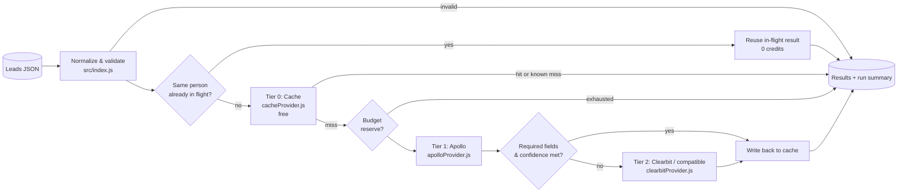
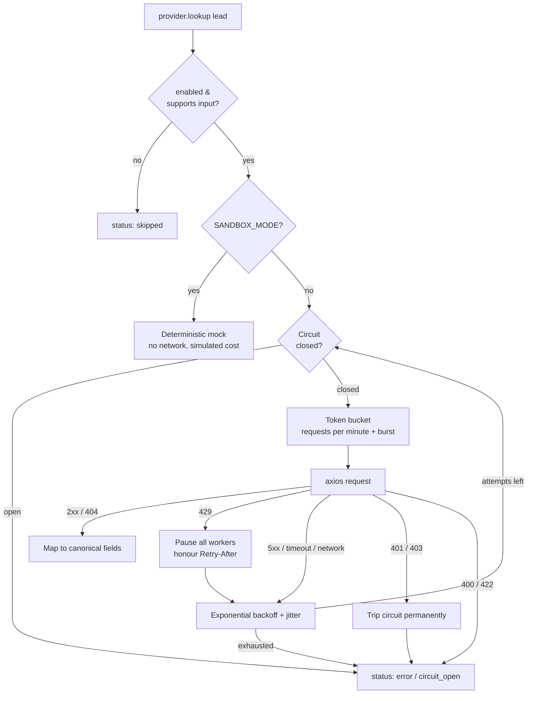

# Outbound Lead Waterfall Router

[](LICENSE)
[](https://nodejs.org)
[](tests)
[](#safety-rails)

**Enrich outbound leads at the lowest possible cost per match.** This Node.js orchestrator runs every lead through a *waterfall* of data providers. It checks the free cache first and calls paid endpoints (Apollo, then Clearbit or a compatible fallback) only when the record still has gaps. It stops the moment the lead is "good enough".

Built and maintained by **DH Robin** ([dhRobin Systems](https://dhrobinsystems.com), `dhrobinsystems`).

---

## Table of contents

- [Why a waterfall](#why-a-waterfall)
- [Architecture](#architecture)
- [How a lead flows](#how-a-lead-flows)
- [Safety rails](#safety-rails)
- [Installation](#installation)
- [Configuration](#configuration)
- [Usage](#usage)
- [Output format](#output-format)
- [Adding a provider (Clay, PDL, Hunter, ...)](#adding-a-provider)
- [Project structure](#project-structure)
- [Testing](#testing)
- [Data protection checklist](#data-protection-checklist)
- [Disclaimer](#️-disclaimer--liability-limitation)
- [License](#license)

---

## Why a waterfall

Sending every lead to every vendor ("spray enrichment") pays several times for the same answer. A waterfall:

| Spray enrichment | Waterfall routing |
| --- | --- |
| Every provider is called for every lead | Providers are called in cost order and the waterfall **stops at the first sufficient result** |
| Pays again for leads you enriched last week | **Tier 0 cache** reuses prior results for free, including remembered misses |
| Conflicting values from multiple vendors | **Field-level merge**: cheaper or earlier tiers win, later tiers only fill gaps |
| Unbounded spend on a bad list | **Hard credit budget** per run, enforced across concurrent workers |
| One vendor outage fails the whole job | **Retries, rate limiting and circuit breakers** degrade gracefully to the next tier |

The sandbox demo (`npm run sandbox`, 12 sample leads) spends **5 simulated credits** where calling both paid providers for every valid lead would cost about **20**.

---

## Architecture



Every external provider extends `BaseProvider`, which wraps each HTTP call in the same resilience stack:



### Components

| Module | Responsibility |
| --- | --- |
| `src/index.js` | Config parsing and validation, lead normalization, waterfall loop, field merge, completeness scoring, budget ledger, in-flight de-duplication, batch concurrency, run summary, CLI |
| `src/providers/baseProvider.js` | Provider contract, sandbox short-circuit, rate limiter + retry + circuit breaker composition, error normalization (lookups never throw) |
| `src/providers/cacheProvider.js` | Tier 0: hashed keys, positive and negative TTLs, LRU cap, atomic owner-only file persistence, `forget()` for erasure requests |
| `src/providers/apolloProvider.js` | Tier 1: Apollo `POST /people/match`, personal-email and phone reveals disabled, rate-limit header awareness |
| `src/providers/clearbitProvider.js` | Tier 2: Clearbit `GET /v2/combined/find`, handles 202 (queued) and 404, configurable base URL for compatible fallbacks |
| `src/utils/rateLimiter.js` | `TokenBucket`, `CircuitBreaker`, `withRetry`, `createGuardedExecutor` |
| `src/utils/errors.js` | `ProviderError` taxonomy, `Retry-After` parsing, HTTP error classification that never copies request config or response bodies |
| `src/utils/logger.js` | winston JSON or pretty logging with recursive secret redaction and email masking |

---

## How a lead flows

1. **Normalize.** Accepts camelCase or snake_case keys, lowercases emails, derives `companyDomain` from the email, and strips control characters. Leads without an email, a LinkedIn URL, or name + company are rejected as `invalid` **before** any credit is spent.
2. **De-duplicate.** If the same person is already being looked up in this batch, the router waits for that result instead of paying twice.
3. **Tier 0: cache.** A fresh hit returns immediately for free. A remembered *confirmed miss* also returns immediately (`CACHE_NEGATIVE_TTL_DAYS`).
4. **Paid tiers, in `WATERFALL_ORDER`.** For each provider:
   - skip it if disabled or if it can't use the available identifiers (Clearbit needs an email);
   - **reserve** its worst-case cost from the run budget (`MAX_CREDITS_PER_RUN`), or stop with `budget_exhausted`;
   - call it with the lead **plus everything discovered so far**, so an email found by Apollo unlocks Clearbit;
   - merge the result field by field (existing values are never overwritten);
   - stop as soon as `REQUIRED_FIELDS` are present and the weakest contributing provider meets `MIN_CONFIDENCE`.
5. **Write back.** Matches are cached. Confirmed misses are negative-cached. Errors and `pending` responses are **not** cached, so they are retried on the next run.

Final statuses: `enriched` · `partial` · `no_match` · `budget_exhausted` · `invalid`.

---

## Safety rails

- **`SANDBOX_MODE=true` by default.** No network calls are made. Providers return deterministic mocks built only from the lead's own input, and spend is reported as *simulated*. Only `false`, `0`, `no` or `off` enable live mode. Typos keep sandbox on and raise an error.
- **Hard budget.** The reserve/settle ledger guarantees concurrent workers can't exceed `MAX_CREDITS_PER_RUN`.
- **No secrets in code.** Keys come only from environment variables (`process.env.APOLLO_API_KEY`, `process.env.CLEARBIT_API_KEY`). A provider without a key disables itself in live mode.
- **Invalid key = stop.** A 401 or 403 permanently opens that provider's circuit for the run, so you never hammer an API with a bad key.
- **PII-safe logs.** Emails are masked (`j***@example.com`). Names and LinkedIn URLs become `[PII]`. Keys, tokens and `Authorization` headers become `[REDACTED]`. Error objects never carry request config or response bodies.
- **Minimal data collection.** Apollo personal-email and phone reveals are explicitly disabled.

---

## Installation

**Requirements:** Node.js 20 or newer.

```bash
git clone https://github.com/dhrobinsystems/outbound-lead-waterfall-router.git
cd outbound-lead-waterfall-router
npm install
cp .env.example .env        # keep SANDBOX_MODE=true for the first runs
npm test                    # 41 tests, no network access needed
npm run sandbox             # dry run on samples/leads.example.json
```

---

## Configuration

All settings are environment variables (loaded from `.env` via dotenv). See [`.env.example`](.env.example) for the annotated template.

| Variable | Default | Description |
| --- | --- | --- |
| `SANDBOX_MODE` | `true` | Mock providers and simulated spend. Set `false` for live calls. |
| `WATERFALL_ORDER` | `apollo,clearbit` | Paid tiers in call order (cheapest or highest-yield first). |
| `REQUIRED_FIELDS` | `email,title,companyDomain` | Fields that must be present to stop the waterfall. |
| `MIN_CONFIDENCE` | `0.7` | Minimum confidence (0-1) of the weakest contributing provider. |
| `ENRICHMENT_CONCURRENCY` | `3` | Leads processed in parallel. |
| `MAX_CREDITS_PER_RUN` | `500` | Hard credit cap across all providers. |
| `CACHE_TTL_DAYS` / `CACHE_NEGATIVE_TTL_DAYS` | `30` / `7` | Freshness windows for matches and confirmed misses. |
| `CACHE_FILE_PATH` | *(empty: memory only)* | Persistent cache file. It contains personal data, so keep it on encrypted storage. |
| `CACHE_MAX_ENTRIES` | `50000` | LRU cap. |
| `FORCE_REFRESH` | `false` | Ignore cached results for this run. |
| `APOLLO_API_KEY` | *(empty)* | Apollo key with access to `api/v1/people/match`. |
| `APOLLO_COST_PER_LOOKUP` | `1` | Credits per successful match (used for budgeting and savings). |
| `APOLLO_RATE_LIMIT_PER_MINUTE` / `_BURST` | `50` / `5` | Client-side throttle. Keep it below your plan's limit. |
| `CLEARBIT_API_KEY` | *(empty)* | Legacy Clearbit key, or a key for a compatible endpoint. |
| `CLEARBIT_BASE_URL` | `https://person.clearbit.com` | Point it at a Clearbit-compatible alternative. |
| `CLEARBIT_RATE_LIMIT_PER_MINUTE` / `_BURST` | `300` / `10` | Client-side throttle. |
| `<PROVIDER>_ENABLED`, `_TIMEOUT_MS`, `_MAX_RETRIES`, `_BASE_URL` | see template | Per-provider overrides. |
| `RETRY_BASE_DELAY_MS` / `RETRY_MAX_DELAY_MS` | `500` / `10000` | Backoff bounds for retryable errors. |
| `CIRCUIT_FAILURE_THRESHOLD` / `CIRCUIT_COOLDOWN_MS` | `5` / `60000` | When to temporarily skip a failing provider. |
| `LOG_LEVEL` / `LOG_FORMAT` | `info` / `json` | `pretty` gives human-readable terminal output. |

> **Clearbit availability:** after HubSpot's acquisition, the standalone Clearbit API is no longer sold to new customers, and API keys exist only for legacy accounts. If you don't have one, set `CLEARBIT_ENABLED=false`, point `CLEARBIT_BASE_URL` at a compatible service, or add a different tier-2 provider (see below).

### Going live

1. Run in sandbox and review the summary and `results.local.json`.
2. Set a small `MAX_CREDITS_PER_RUN` (for example `20`) and a small test file.
3. Add `APOLLO_API_KEY` (and optionally a tier-2 key), then set `SANDBOX_MODE=false`.
4. Compare `creditsSpent` with what your provider dashboards report, then raise the budget gradually.

---

## Usage

### CLI

```bash
# Dry run (forces sandbox regardless of .env)
node src/index.js --sandbox --input samples/leads.example.json --output results.local.json

# Live run (SANDBOX_MODE=false and keys in .env)
node src/index.js --input leads.json --output results.local.json
```

Input is a JSON array of leads, or `{ "leads": [...] }`. Accepted keys: `id`, `email`, `first_name`/`firstName`, `last_name`/`lastName`, `company_name`/`company`, `company_domain`/`domain`/`website`, `linkedin_url`. Logs go to **stderr** and the run summary goes to **stdout**, so you can pipe it: `node src/index.js -i leads.json | jq .creditsSaved`.

### Library

```js
const { buildConfig, WaterfallRouter } = require('outbound-lead-waterfall-router');

const { config, errors } = buildConfig(process.env);
if (errors.length) throw new Error(errors.join('\n'));

async function enrich() {
  const router = new WaterfallRouter({ config });
  const { results, summary } = await router.run([
    { id: 'lead-001', email: 'example@domain.com', first_name: 'Jane', last_name: 'Doe' }
  ]);
  return { results, summary };
}
```

---

## Output format

Each result:

```json
{
  "id": "lead-001",
  "status": "enriched",
  "data": { "email": "example@domain.com", "title": "VP Revenue Operations", "companyDomain": "domain.com", "industry": "Computer Software" },
  "sources": { "email": "input", "title": "apollo", "industry": "clearbit" },
  "confidence": 0.85,
  "missingFields": [],
  "credits": 2,
  "attempts": [
    { "provider": "cache", "status": "miss", "credits": 0 },
    { "provider": "apollo", "status": "matched", "credits": 1, "durationMs": 412, "fieldsFilled": ["title"] },
    { "provider": "clearbit", "status": "matched", "credits": 1, "durationMs": 380, "fieldsFilled": ["industry"] }
  ],
  "validationErrors": []
}
```

The run summary reports `matchRate`, `fullEnrichmentRate`, `creditsSpent`, `naiveCreditsEstimate`, `creditsSaved`, cache hits, per-provider calls, matches, errors and credits, plus each provider's circuit state.

---

## Adding a provider

Clay, People Data Labs, Hunter, an internal data warehouse, or any HTTP endpoint can be added as a tier:

```js
// src/providers/myProvider.js
const axios = require('axios');
const { BaseProvider, RESULT_STATUS } = require('./baseProvider');

class MyProvider extends BaseProvider {
  constructor(options) {
    super(Object.assign({ name: 'myprovider', tier: 3 }, options));
    this.http = options.httpClient || axios.create({
      baseURL: options.baseUrl,
      timeout: options.timeoutMs,
      headers: { Authorization: 'Bearer ' + options.apiKey } // from process.env only
    });
  }

  supports(lead) { return Boolean(lead.email || lead.companyDomain); }

  async performLookup(lead) {
    const res = await this.http.post('/enrich', { email: lead.email });
    if (!res.data || !res.data.person) return { status: RESULT_STATUS.NO_MATCH, cost: 0 };
    return { status: RESULT_STATUS.MATCHED, confidence: 0.8, cost: this.costPerLookup, data: { title: res.data.person.title } };
  }

  mockLookup(lead) { return { status: RESULT_STATUS.NO_MATCH }; } // used in SANDBOX_MODE
}
module.exports = { MyProvider };
```

Then register it in `PROVIDER_FACTORIES` and `buildConfig()` in `src/index.js`, add it to `WATERFALL_ORDER`, and write tests with the mock HTTP client in `tests/helpers.js`. Clay is usually table- and webhook-driven rather than a synchronous lookup API, so a Clay tier typically calls an HTTP endpoint you expose from your Clay workflow, or reads a Clay export.

---

## Project structure

```
outbound-lead-waterfall-router/
├── src/
│   ├── index.js                  # orchestrator, config, CLI
│   ├── providers/
│   │   ├── baseProvider.js       # contract + resilience + sandbox
│   │   ├── cacheProvider.js      # tier 0
│   │   ├── apolloProvider.js     # tier 1
│   │   └── clearbitProvider.js   # tier 2 (legacy / compatible)
│   └── utils/
│       ├── errors.js
│       ├── logger.js
│       └── rateLimiter.js
├── tests/                        # node --test, no network
├── samples/leads.example.json    # fictional leads, example.* domains only
├── .env.example
├── DISCLAIMER.md
├── LICENSE
└── package.json
```

---

## Testing

```bash
npm test
```

The 41 tests cover the waterfall stop condition, field-level merge, hint propagation between tiers, confidence gating, cache hits and negative caching, `FORCE_REFRESH`, graceful degradation, budget enforcement under concurrency, in-flight de-duplication, input normalization, config validation, Apollo and Clearbit request and response mapping (429/503 retries, 401 circuit trip, 202 pending, 404 no match), token-bucket timing, backoff with `Retry-After`, circuit-breaker state transitions, cache TTL, LRU, hashed keys, atomic file persistence and erasure, and log redaction against real winston output. All HTTP is mocked and time uses a fake clock.

---

## Data protection checklist

- Only enrich prospects you have a lawful basis to process (for example, legitimate interest under GDPR) and honour opt-outs.
- Keep `.env`, `results*.json`, `*.local.json` and `.cache/` out of version control (already in `.gitignore`).
- Store `CACHE_FILE_PATH` on encrypted storage and use `cache.forget(lead)` for deletion requests.
- Review each provider's terms on storing and re-using enriched data before you increase `CACHE_TTL_DAYS`.

---

## ⚠️ Disclaimer & Liability Limitation

Use at your own risk. The code, workflows, and scripts provided in this repository (`outbound-lead-waterfall-router`) are for educational and architectural demonstration purposes.

- **No Liability:** The author and dhRobin Systems assume no responsibility or liability for any direct, indirect, incidental, or consequential damages resulting from the use, misuse, or deployment of these scripts.
- **No Warranty:** All software, configuration templates, and JavaScript modules are provided "AS IS" without warranty of any kind, express or implied, including but not limited to merchantability, fitness for a particular purpose, or non-infringement.
- **Production Testing Required:** Always test thoroughly in an isolated staging environment with `SANDBOX_MODE=true` enabled and a conservative `MAX_CREDITS_PER_RUN` before connecting live Apollo, Clearbit, Clay, or other enrichment provider credentials.
- **Third-Party APIs & Compliance:** Users are solely responsible for complying with the terms of service, rate limits, credit policies, data privacy regulations (GDPR/CCPA), and anti-spam laws (e.g. CAN-SPAM, CASL, PECR) of Apollo, Clearbit, Clay, and any other connected data provider, and for having a lawful basis to process prospect data.

> The full disclaimer is also available in [DISCLAIMER.md](DISCLAIMER.md).

---

## License

Released under the [MIT License](LICENSE). Copyright (c) 2026 DH Robin (dhRobin Systems).
